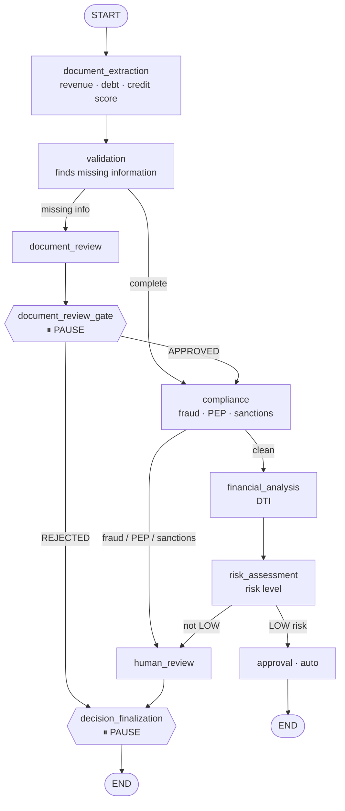
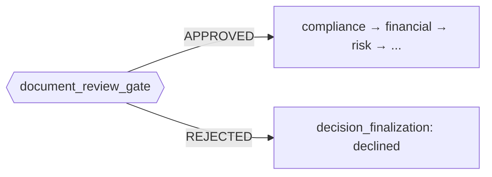

# Human-in-the-Loop AI: Building an LLM Loan-Underwriting Workflow That Knows When to Pause for a Human

*How I used langgraph4j and Spring AI to turn a pile of LLM calls into a resumable workflow that checkpoints its state, waits days for a human decision, and picks up exactly where it left off.*

> **Note for Medium:** diagrams are in Mermaid (GitHub renders them live). For Medium, render once on [mermaid.live](https://mermaid.live) and paste a screenshot.
>
> **Disclaimer:** this is a personal learning project, not production software, and not financial or lending advice. All data is synthetic.

---

## The problem with “just call the LLM”

Most LLM demos are one shot: prompt in, answer out. But real business processes aren’t one shot. Underwriting a commercial loan has *stages* — read the documents, check they’re complete, screen for compliance, run the numbers, score the risk — and crucially, **sometimes it has to stop and wait for a person.** A human might need days to approve a high-risk case or chase a missing bank statement.

That “stop and wait, possibly for days, then continue” requirement is the whole challenge. An HTTP request can’t stay open that long. So how does a workflow *pause mid-flight*, survive, and resume later from a completely separate request?

That’s what I set out to learn by building a **commercial loan underwriting workflow** with **Spring Boot**, **Spring AI** (OpenAI), and **[langgraph4j](https://github.com/bsorrentino/langgraph4j)** — a Java port of the graph-based agent framework.

---

## The workflow as a graph

The key mental shift is to stop thinking in function calls and start thinking in a **graph of nodes and edges**. Each node is a step (most of them call an LLM); each edge is a routing decision based on the current state.



An application flows top-down. There are exactly **three outcomes**: auto-approved (clean, low-risk), **paused for a human**, or declined. The two ⏸ markers are where it stops — and that’s the interesting part.

---

## How a graph pauses (and why you need a checkpoint)

langgraph4j supports a mechanism called **`interruptBefore`**. You compile the graph telling it: *stop right before these nodes.* When the run reaches one, langgraph4j **checkpoints the entire state** into a saver and returns control to the caller. The HTTP request completes, returning `WAITING_FOR_HUMAN`. Days later, a separate request resumes from the checkpoint.

```java
CompileConfig.builder()
    .checkpointSaver(saver)
    .interruptBefore(DOCUMENT_REVIEW_GATE, DECISION_FINALIZATION)
    .build();
```

Two things make this work in Spring:

1. **The checkpoint saver must be a single shared singleton.** It’s the memory that links the “start” call to the later “resume” call. A per-request saver would be empty on resume — I learned that the obvious way.
2. **`threadId = applicationId`.** Every start / status / resume call for one application points at the same checkpoint history, so the framework knows which paused run to continue.

The service orchestration is then simple:
- **start** → `graph.invoke(input, config)` → runs until `END` or a pause.
- **resume** → write the human’s decision into the checkpoint → `graph.invoke(null, config)` (null means “continue, don’t restart”).

---

## The design insight: two *different* human gates

This is the lesson that only showed up once I started testing with real inputs. My first version had **one** human-review node wired straight to the final decision. It worked — but it was wrong, and the bug was conceptual, not syntactic.

There are actually **two completely different kinds of human review** in underwriting, and they mean opposite things:

| | Missing-docs gate | Final decision gate |
|---|---|---|
| Reached when | documents are incomplete | compliance hit, or risk not LOW |
| **APPROVE means** | *proceed with underwriting* → continue to compliance | *approve the loan* → done |
| **REJECT means** | decline the application | decline the loan |

My first design made approving the *missing-docs* review jump straight to “loan completed” — skipping compliance, financial analysis and risk entirely. That’s a serious logic error: a reviewer saying “okay, the docs are fine, carry on” is **not** the same as “approve this loan.”

The fix was to make the missing-docs review a **separate gate** that, on approval, routes *back into the pipeline* at the compliance step:



To keep the two gates from interfering, I gave them **separate state fields** (`documentReviewDecision` vs `decision`) so approving the docs never accidentally pre-fills the final loan decision. Both are answered through the *same* REST endpoint — the service inspects *where* the run is paused (`snapshot.next()`) to know which gate it’s resuming. So a single application can legitimately require **two** human calls: “approve the docs,” then later “approve the loan.”

That one refactor — splitting a shared node into two intention-specific gates — taught me more about workflow design than any amount of reading.

---

## Making LLM nodes not blow up

LLMs are probabilistic, and that bites you in boring ways. The prompts correctly tell the model “if a value is missing, return null — don’t invent a zero.” But Java’s `Map.of(...)` **rejects null values** with an NPE. So a perfectly reasonable LLM response — “I couldn’t find the revenue” → `null` — crashed the whole graph.

The fix is a pattern every node now follows: build a mutable map and **only write the fields the model actually produced**, letting the state keep its defaults otherwise.

```java
Map<String, Object> out = new HashMap<>();
if (result != null && result.dti() != null) {
    out.put(UnderwritingState.DTI_RATIO, result.dti());
}
return out;
```

A few more hard-won habits:
- **Treat LLM output as untrusted data** — the prompts explicitly instruct the model to ignore any instructions embedded in the document text (prompt-injection defense).
- **Keep a clean audit trail** — every state change appends to an `auditLog`, so even after a decision clears the “why,” the full history survives.
- **Clear stale state on completion** — once finalized, I blank the `humanReviewReason` so a `COMPLETED` application doesn’t keep reporting “manual review required.” (That was an actual bug report from my own testing: *“status is completed but it still says manual review.”*)

---

## What I actually learned

- **Model multi-step AI work as a graph**, not a script. Nodes + edges make the routing explicit and the pauses natural.
- **Pausing is a checkpoint problem.** `interruptBefore` + a shared saver + a stable `threadId` turns a long-running, human-gated process into two short HTTP calls.
- **“A human reviews this” is not one thing.** Different gates mean different things; collapsing them creates silent logic bugs. Separate the intent, separate the state.
- **LLM nodes need defensive plumbing** — null-safety, untrusted-input handling, and state hygiene — because the model *will* return something you didn’t expect.
- **Human-in-the-loop is a feature, not a fallback.** The system’s job isn’t to replace the underwriter; it’s to do the legwork and **know precisely when to stop and ask.**

If you’re building anything agentic beyond a chatbot, the pause/resume + checkpoint pattern is worth internalizing. Real work has gates, and the interesting engineering is in how gracefully your system waits.

*Built with Spring Boot, Spring AI (OpenAI), and langgraph4j. Checkpoints are in-memory for the demo; a durable saver (file / Redis / JDBC) would make paused applications survive restarts.*
